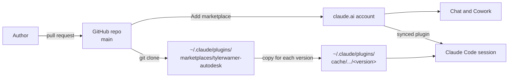

# Claude Plugin Distribution

This repository is a Claude plugin marketplace (`tylerwarner-autodesk`) with one plugin for each focus:

| Plugin | Skills |
|---|---|
| `aps-documentation` | `aps-docs` |
| `inventor-api` | `inventor-api-traps`, `inventor-modeling`, `inventor-drawings` |
| `inventor-ilogic` | `inventor-ilogic` |
| `inventor-data` | `inventor-projects-and-files` |

Claude installs each plugin from the GitHub repo `tylerwarner33/autodesk-agent-skills`. A user installs only the plugins that they need.
One plugin folder works on all the Claude surfaces. Each surface loads the parts that it supports.

## Why the plugins are split by focus

- A user who writes iLogic rules does not need the APS skills, and the reverse. Each plugin that is not installed adds no skill descriptions to the context.
- A plugin name is the slash prefix of its skills (`/inventor-api:inventor-modeling`). A name of the form `<product>-<area>` says what the plugin is for, with no `-skills` suffix. The same plugin can later also hold a hook or an MCP server.
- Each plugin is self-contained: a skill names only the skills of its own plugin.
- All plugins share one version, so `CHANGELOG.md` has one version for each pull request.

## The Inventor skills and an Inventor MCP server

The Inventor skills name only the Inventor API, so they work with any tool that drives Inventor: an add-in, a plugin, a Design Automation app, or any Inventor MCP server.
An MCP server keeps the steps that belong to its own tools (ex. which tool to call to check the health of a feature) in its own skills, and its instructions can point a model to these plugins.
`Pipelines/Scripts/Test-SkillPortability.ps1` fails when an Inventor skill names a tool or a script helper of one server.

## What a plugin contains

| Part | Where | What it does |
|---|---|---|
| Skills | `plugins/<plugin>/skills/<name>/` | Shown as `/<plugin>:<name>` (ex. `/aps-documentation:aps-docs`). Claude also loads a skill by itself when a request matches its description. |

A plugin can also have hooks, MCP servers, subagents, commands, and output styles. Add them in the same pull request process as a skill. Hooks and MCP servers are tier 2 (see [Security-And-Governance.md](./Security-And-Governance.md)).
A plugin cannot set the status line.

## Surfaces

| Part | Chat (claude.ai, desktop app, mobile) | Cowork | Claude Code |
|---|---|---|---|
| Skills | Loads | Loads | Loads |
| Commands | Loads as a skill | Loads | Loads |
| Remote MCP server | The user connects it on the **Connectors** tab | The user connects it on the **Connectors** tab | Loads |
| Agents and hooks | Ignored | Loads | Loads |
| Local MCP server | Ignored | Loads when the session runs on the computer | Loads |
| Output styles, LSP servers, `settings` | Ignored | Ignored | Loads |
| A top-level `bin/` folder | The plugin cannot be installed | The plugin cannot be installed | Loads |

Rules that keep the plugin working on all surfaces:

- Do not add a top-level `bin/` folder. claude.ai and Cowork then refuse the whole plugin.
- In a skill, reference a bundled file as `${CLAUDE_SKILL_DIR}/scripts/<file>`, and say what to do when the placeholder is not replaced. Claude Code and Cowork replace it. Chat copies the skill folder into the code execution sandbox and does not replace it.
- A skill script that uses the network needs network egress in chat and Cowork. Name each domain in the skill `compatibility` field and in [Setup-Guide.md](./Setup-Guide.md).
- `allowed-tools` applies only in Claude Code. The other surfaces ignore it.

## How it works



1. The repository root is the marketplace (`.claude-plugin/marketplace.json`, name `tylerwarner-autodesk`). Each plugin is in `plugins/<plugin>/` (`.claude-plugin/plugin.json` in that folder, `"source": "./plugins/<plugin>"` in the marketplace). The installed copy holds only the plugin folder, so Claude does not load the docs, evals, or pipelines. Claude Code also keeps a full clone of the repository in `~/.claude/plugins/marketplaces/`, and that clone has all the folders.
2. A user adds the marketplace, then installs the plugins that they need. In claude.ai or the desktop app, a plugin is saved to the account, and it syncs to Claude Code when Claude Code is signed in to the same account. A plugin installed from the Claude Code command line stays on that machine.
3. The version is `"version"` in `plugins/<plugin>/.claude-plugin/plugin.json`. All plugins share one version. Claude installs a new copy only when that value changes. Each pull request bumps it in every plugin and adds the same version to [CHANGELOG.md](../CHANGELOG.md).
4. The `renames` map in `marketplace.json` keeps the history of plugin names. Version 3.0.0 renamed `autodesk-skills` to `aps-documentation`. Claude Code moves the settings of a renamed plugin, and a user of this marketplace runs `claude plugin install aps-documentation@tylerwarner-autodesk` once.

## Install

### claude.ai, the desktop app, and Cowork

Open **Customize > Plugins**, select **Add > Add marketplace**, and enter `tylerwarner33/autodesk-agent-skills`. Then add the plugins that you need.
To get updates without a manual check, turn on **Sync automatically** on the marketplace.
A private repo needs the Claude GitHub App, with access to the repo.

### Claude Code

```
claude plugin marketplace add tylerwarner33/autodesk-agent-skills
claude plugin install <plugin>@tylerwarner-autodesk
```

To turn on auto-update, open Claude Code and run `/plugin`, choose the marketplace, and turn on auto-update.
You can also add `"autoUpdate": true` to the marketplace entry in `~/.claude/settings.json`:

```json
"extraKnownMarketplaces": {
  "tylerwarner-autodesk": {
    "source": {
      "source": "github",
      "repo": "tylerwarner33/autodesk-agent-skills"
    },
    "autoUpdate": true
  }
}
```

A private repo needs a git credential that can read it. Claude Code runs `git` with the credential helper of the user, with prompts turned off.

## Update

A merged change reaches a user only when `version` changed.
In claude.ai or the desktop app, select **Check for updates** on the marketplace.
In Claude Code, these commands update by hand:

| Command | What it does |
|---|---|
| `claude plugin marketplace update tylerwarner-autodesk` | Fetches the latest marketplace from GitHub. It does not update the plugins. |
| `claude plugin update <plugin>@tylerwarner-autodesk` | Installs the new version of one plugin. |
| `/reload-plugins` | Loads the new version in the open session. |

## Test a branch before it merges

### Claude Code

Load the working folder as the plugin. Nothing is installed:

```
claude --plugin-dir plugins/<plugin>
```

Run `/reload-plugins` after each edit.
To test a pushed branch from a marketplace, add it with a ref:

```
claude plugin marketplace add tylerwarner33/autodesk-agent-skills@<branch>
```

### claude.ai and Cowork

1. Zip the `plugins/<plugin>` folder. The zip must have `.claude-plugin/plugin.json` at its root, or inside one top-level folder.
2. In claude.ai, select **Customize > Plugins > Add > Upload plugin**, and select the zip.
3. Open a new chat. Ask a question that the plugin covers (ex. an APS question for `aps-documentation`), and check that Claude loads the skill.
4. When the test is done, remove the uploaded plugin, so that it does not hide the marketplace copy.

## Validate

```
claude plugin validate .
claude plugin validate plugins/<plugin>
```

The first command checks the marketplace and its `renames` map. The second checks one plugin: run it for each plugin. Each must report no error and no warning in the manifests.

## References

- <https://claude.com/docs/plugins/overview>
- <https://claude.com/docs/plugins/platform-support>
- <https://claude.com/docs/plugins/build>
- <https://code.claude.com/docs/en/plugins>
- <https://code.claude.com/docs/en/plugin-marketplaces>
