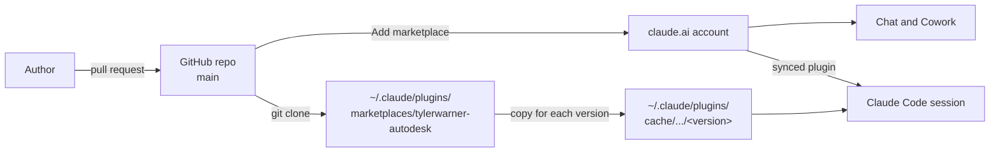

# Claude Plugin Distribution

This repository is a Claude plugin marketplace (`tylerwarner-autodesk`) with one plugin, `autodesk-skills`.
Claude installs the plugin from the GitHub repo `tylerwarner33/autodesk-claude-plugins`.
One plugin folder works on all the Claude surfaces. Each surface loads the parts that it supports.

## What the plugin contains

| Part | Where | What it does |
|---|---|---|
| Skills | `skills/<name>/` | Shown as `/autodesk-skills:<name>` (ex. `/autodesk-skills:aps-docs`). Claude also loads a skill by itself when a request matches its description. |

A plugin can also have hooks, MCP servers, subagents, commands, and output styles. Add them in the same pull request process as a skill. Hooks and MCP servers are tier 2 (see [Security-And-Governance.md](./Security-And-Governance.md)).
A plugin cannot set the status line.

## Surfaces

| Part | Chat (claude.ai, desktop app, mobile) | Cowork | Claude Code |
|---|---|---|---|
| Skills | Loads | Loads | Loads |
| Commands | Loads as a skill | Loads | Loads |
| Remote MCP server | The user connects it on the **Connectors** tab | The user connects it on the **Connectors** tab | Loads |
| Agents and hooks | Ignored | Loads | Loads |
| Local MCP server | Ignored | Loads when the session runs on the computer | Loads |
| Output styles, LSP servers, `settings` | Ignored | Ignored | Loads |
| A top-level `bin/` folder | The plugin cannot be installed | The plugin cannot be installed | Loads |

Rules that keep the plugin working on all surfaces:

- Do not add a top-level `bin/` folder. claude.ai and Cowork then refuse the whole plugin.
- In a skill, reference a bundled file as `${CLAUDE_SKILL_DIR}/scripts/<file>`, and say what to do when the placeholder is not replaced. Claude Code and Cowork replace it. Chat copies the skill folder into the code execution sandbox and does not replace it.
- A skill script that uses the network needs network egress in chat and Cowork. Name each domain in the skill `compatibility` field and in [Setup-Guide.md](./Setup-Guide.md).
- `allowed-tools` applies only in Claude Code. The other surfaces ignore it.

## How it works



1. The repository root is the marketplace (`.claude-plugin/marketplace.json`, name `tylerwarner-autodesk`) and its only plugin (`.claude-plugin/plugin.json`, name `autodesk-skills`, `"source": "."`).
2. A user adds the marketplace, then installs the plugin. In claude.ai or the desktop app, the plugin is saved to the account, and it syncs to Claude Code when Claude Code is signed in to the same account. A plugin installed from the Claude Code command line stays on that machine.
3. The version is `"version"` in `.claude-plugin/plugin.json`. Claude installs a new copy only when that value changes. Each pull request bumps it and adds the same version to [CHANGELOG.md](../CHANGELOG.md).

## Install

### claude.ai, the desktop app, and Cowork

Open **Customize > Plugins**, select **Add > Add marketplace**, and enter `tylerwarner33/autodesk-claude-plugins`. Then add the `autodesk-skills` plugin.
To get updates without a manual check, turn on **Sync automatically** on the marketplace.
A private repo needs the Claude GitHub App, with access to the repo.

### Claude Code

```
claude plugin marketplace add tylerwarner33/autodesk-claude-plugins
claude plugin install autodesk-skills@tylerwarner-autodesk
```

To turn on auto-update, open Claude Code and run `/plugin`, choose the marketplace, and turn on auto-update.
You can also add `"autoUpdate": true` to the marketplace entry in `~/.claude/settings.json`:

```json
"extraKnownMarketplaces": {
  "tylerwarner-autodesk": {
    "source": {
      "source": "github",
      "repo": "tylerwarner33/autodesk-claude-plugins"
    },
    "autoUpdate": true
  }
}
```

A private repo needs a git credential that can read it. Claude Code runs `git` with the credential helper of the user, with prompts turned off.

## Update

A merged change reaches a user only when `version` changed.
In claude.ai or the desktop app, select **Check for updates** on the marketplace.
In Claude Code, these commands update by hand:

| Command | What it does |
|---|---|
| `claude plugin marketplace update tylerwarner-autodesk` | Fetches the latest marketplace from GitHub. It does not update the plugin. |
| `claude plugin update autodesk-skills@tylerwarner-autodesk` | Installs the new version of the plugin. |
| `/reload-plugins` | Loads the new version in the open session. |

## Test a branch before it merges

### Claude Code

Load the working folder as the plugin. Nothing is installed:

```
claude --plugin-dir .
```

Run `/reload-plugins` after each edit.
To test a pushed branch from a marketplace, add it with a ref:

```
claude plugin marketplace add tylerwarner33/autodesk-claude-plugins@<branch>
```

### claude.ai and Cowork

1. Zip the repository folder. The zip must have `.claude-plugin/plugin.json` at its root, or inside one top-level folder. Do not include `.git/`.
2. In claude.ai, select **Customize > Plugins > Add > Upload plugin**, and select the zip.
3. Open a new chat. Ask an APS question, and check that Claude loads the skill.
4. When the test is done, remove the uploaded plugin, so that it does not hide the marketplace copy.

## Validate

```
claude plugin validate .
```

The command must report no error and no warning.

## References

- <https://claude.com/docs/plugins/overview>
- <https://claude.com/docs/plugins/platform-support>
- <https://claude.com/docs/plugins/build>
- <https://code.claude.com/docs/en/plugins>
- <https://code.claude.com/docs/en/plugin-marketplaces>
