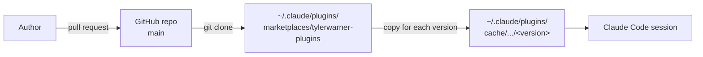

# Claude Code Plugin Distribution

This repository is a Claude Code plugin marketplace (`tylerwarner-plugins`) with one plugin, `autodesk-skills`.
Claude Code installs the plugin from the GitHub repo `tylerwarner33/claude-plugin`.

## What the plugin contains

| Part | Where | What it does |
|---|---|---|
| Skills | `skills/<name>/` | Shown in Claude Code as `/autodesk-skills:<name>` (ex. `/autodesk-skills:aps-docs`). Claude also loads a skill by itself when a request matches its description. |

A plugin can also have hooks, MCP servers, subagents, commands, and output styles. Add them in the same pull request process as a skill. Hooks and MCP servers are tier 2 (see [Security-And-Governance.md](./Security-And-Governance.md)).
A plugin cannot set the status line.

## How it works



1. The repository root is the marketplace (`.claude-plugin/marketplace.json`, name `tylerwarner-plugins`) and its only plugin (`.claude-plugin/plugin.json`, name `autodesk-skills`, `"source": "."`).
2. A user adds the marketplace, then installs the plugin.
3. The version is `"version"` in `.claude-plugin/plugin.json`. Claude Code installs a new copy only when that value changes. Each pull request bumps it and adds the same version to [CHANGELOG.md](../CHANGELOG.md).

## Install

```
claude plugin marketplace add tylerwarner33/claude-plugin
claude plugin install autodesk-skills@tylerwarner-plugins
```

To turn on auto-update, open Claude Code and run `/plugin`, choose the marketplace, and turn on auto-update.
You can also add `"autoUpdate": true` to the marketplace entry in `~/.claude/settings.json`:

```json
"extraKnownMarketplaces": {
  "tylerwarner-plugins": {
    "source": {
      "source": "github",
      "repo": "tylerwarner33/claude-plugin"
    },
    "autoUpdate": true
  }
}
```

A private repo needs a git credential that can read it. Claude Code runs `git` with the credential helper of the user, with prompts turned off.

## Update

A merged change reaches a user only when `version` changed. These commands update by hand:

| Command | What it does |
|---|---|
| `claude plugin marketplace update tylerwarner-plugins` | Fetches the latest marketplace from GitHub. It does not update the plugin. |
| `claude plugin update autodesk-skills@tylerwarner-plugins` | Installs the new version of the plugin. |
| `/reload-plugins` | Loads the new version in the open session. |

## Test a branch before it merges

Load the working folder as the plugin. Nothing is installed:

```
claude --plugin-dir .
```

Run `/reload-plugins` after each edit.
To test a pushed branch from a marketplace, add it with a ref:

```
claude plugin marketplace add tylerwarner33/claude-plugin@<branch>
```

## Validate

```
claude plugin validate .
```

The command must report no error and no warning.

## References

- <https://code.claude.com/docs/en/plugins>
- <https://code.claude.com/docs/en/plugin-marketplaces>
