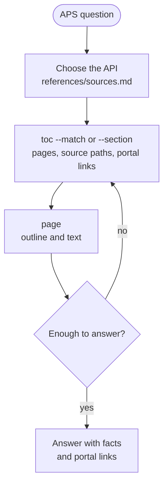

# Skill Catalog

What each skill does, its workflow, and its source files.
Each `SKILL.md` is instructions for the model, so the documentation for people is here, not in `SKILL.md`.

| Plugin | Skills |
|---|---|
| `aps-documentation` | [aps-docs](#aps-docs) |
| `inventor-api` | [inventor-api-traps](#inventor-api-traps), [inventor-modeling](#inventor-modeling), [inventor-drawings](#inventor-drawings) |
| `inventor-ilogic` | [inventor-ilogic](#inventor-ilogic) |
| `inventor-data` | [inventor-projects-and-files](#inventor-projects-and-files) |

## aps-docs

**Plugin:** `aps-documentation`
**Source:** [`plugins/aps-documentation/skills/aps-docs/SKILL.md`](../plugins/aps-documentation/skills/aps-docs/SKILL.md)
**Script:** [`scripts/aps_docs.py`](../plugins/aps-documentation/skills/aps-docs/scripts/aps_docs.py) (tier 2, with [tests](../plugins/aps-documentation/skills/aps-docs/tests/test_aps_docs.py))
**References:** [sources](../plugins/aps-documentation/skills/aps-docs/references/sources.md) | [glossary](../plugins/aps-documentation/skills/aps-docs/references/glossary.md) | [worked example](../plugins/aps-documentation/skills/aps-docs/references/worked-example.md)
**Needs:** Python 3.9 or later, and internet access. No packages. In claude.ai and Cowork: code execution, with network egress to `developer.doc.autodesk.com` and `developer.doc.config.autodesk.com`.

Answers questions about Autodesk Platform Services (APS, formerly Forge) from the live documentation, not from the memory of the model.
Start it by name with `/aps-documentation:aps-docs` (in chat, type `/` and select it), or ask an APS question.

The APS portal is a JavaScript app, so the skill reads the static sources of the same content: a table of contents (TOC) JSON file for each API, and an HTML file for each page.
The script `aps_docs.py` has 6 commands:

| Command | What it does |
|---|---|
| `sources` | Prints the source IDs, and which API answers which kind of question. `--match` prints only the matching rows. |
| `glossary` | Prints APS terms and acronyms. `--match` prints only the matching rows. |
| `example` | Prints a worked example of the method. |
| `toc <source_id>` | Lists the sections of an API, the pages of one section (`--section`), or the pages that match a regex (`--match`). Each page has its source path and its portal link. |
| `page <source path>` | Prints the outline and the text of a page. `--headings` prints only the outline, and `--code` only the code blocks. Table rows show as `cell \| cell`. |
| `portal-url <source path>` | Prints the portal link of a page. |

The portal link comes from the `url_path` chain in the TOC, not from the source path. The 2 are often different (ex. the source `model-derivative/v2/overview.html` is the portal page `model-derivative/v2/developers_guide/overview/`). If a page is not in the TOC, the script guesses from the source path and says so.
The script caches each TOC for 24 hours in the system temp folder.

### Changes from the original skill

The skill started as `aps-docs-portal` from the Autodesk Platform Services `skills` repository.

- A Python script replaces the `curl`, `jq`, and `htmlq` commands, so it works on Windows without extra tools.
- Portal links come from the TOC. The original rule, which rewrote the source path, gave wrong links for many pages.
- The webhook example uses the events in the live docs. The original listed events that do not exist (ex. `dm.item.created`).
- The source table has the current API titles (ex. `acc_v1` is now "Forma APIs").

## The Inventor skills

The Inventor skills started as the topic skills of the [Autodesk Inventor MCP Server](https://github.com/tylerwarner33/autodesk-inventor-mcp), which served them over MCP.
Each fact in them made real code fail in a live Inventor session.
Here they name only the Inventor API, so they work with any tool that drives Inventor: an add-in, a plugin, a Design Automation app, or any Inventor MCP server.
The steps that belong to that server's tools stay in the server's own skills.

| Skill | Was in the server |
|---|---|
| `inventor-api-traps` | `interop` |
| `inventor-modeling` | `modeling` |
| `inventor-drawings` | `drawings` |
| `inventor-ilogic` | `ilogic` |
| `inventor-projects-and-files` | `projects-and-files` |

What changed in the move:

- Each tool name of the server (ex. `inventor_health`) became the Inventor API member or the check that it stands for (ex. `PartFeature.HealthStatus`).
- Each script helper of the server (ex. a transaction helper, unit helpers, an iLogic helper) became the API calls in full.
- A reference to a skill in another plugin became the fact itself, so each plugin works alone.

## inventor-api-traps

**Plugin:** `inventor-api`
**Source:** [`plugins/inventor-api/skills/inventor-api-traps/SKILL.md`](../plugins/inventor-api/skills/inventor-api-traps/SKILL.md)

The Inventor COM API facts that make .NET code fail to compile or throw at run time.
Start it by name with `/inventor-api:inventor-api-traps`, or write or fix code that calls the Inventor API.

- Members typed as `object` (ex. `Parameter.Value`), and how to read a text or boolean parameter.
- Casts that do not work (ex. `PartComponentDefinition` to `ComponentDefinition`), and members that C# must call as methods (ex. `get_Units()`).
- Transactions as one Undo step, and iLogic through `dynamic`.
- The known causes of E_FAIL and E_INVALIDARG, and collection quirks.

## inventor-modeling

**Plugin:** `inventor-api`
**Source:** [`plugins/inventor-api/skills/inventor-modeling/SKILL.md`](../plugins/inventor-api/skills/inventor-modeling/SKILL.md)

How to write geometry in a part or an assembly, and how to verify it.
Start it by name with `/inventor-api:inventor-modeling`, or ask for a change that names a face, a direction, or units.

- A named face means the ViewCube face. On an unmodified part, Y is up.
- Inventor stores lengths in centimetres and angles in radians.
- A feature extent direction is relative to the sketch normal. A cut in the wrong direction gives `kDriverLostHealth`, not an error.
- After each write: update, read the feature health, and check the geometry that the write was for.

## inventor-drawings

**Plugin:** `inventor-api`
**Source:** [`plugins/inventor-api/skills/inventor-drawings/SKILL.md`](../plugins/inventor-api/skills/inventor-drawings/SKILL.md)

How to read, measure, balloon, and change drawings.
Start it by name with `/inventor-api:inventor-drawings`, or ask to check or change a drawing.

- Leaders as trees, balloons and BOM rows, and how to build a leader.
- Sheets that must be active, views with the same name, and scale before annotations.
- Style libraries that override a template, and what the API cannot do (`.styxml` export, OLE objects).
- An image of a sheet with no window, through a transient camera.

## inventor-ilogic

**Plugin:** `inventor-ilogic`
**Source:** [`plugins/inventor-ilogic/skills/inventor-ilogic/SKILL.md`](../plugins/inventor-ilogic/skills/inventor-ilogic/SKILL.md)

How iLogic rules behave when code changes a document.
Start it by name with `/inventor-ilogic:inventor-ilogic`, or ask to change parameters of a model with rules, or to read, change, or run a rule.

- One parameter write with the rules on took 85 s on a template with many rules. With the rules off, under 0.1 s.
- Rule error dialogs block every call, and iLogic shows the same error only once in 120 minutes.
- The Security Alert and the Security Advisor: what each button does. Never answer them for the user.

## inventor-projects-and-files

**Plugin:** `inventor-data`
**Source:** [`plugins/inventor-data/skills/inventor-projects-and-files/SKILL.md`](../plugins/inventor-data/skills/inventor-projects-and-files/SKILL.md)

What decides whether a file can change, and how to save, copy, open, and close files safely.
Start it by name with `/inventor-data:inventor-projects-and-files`, or ask to save, copy, or change a file.

- Library paths and Vault are 2 separate read-only layers, and both give E_FAIL.
- A file saved in a newer release, even a newer point release, does not open in an older one.
- `MemberEditScope` of model states, Content Center inserts, and copies for a test.
- Close only the documents that your code opened, drawings first. Never `Documents.CloseAll`.
