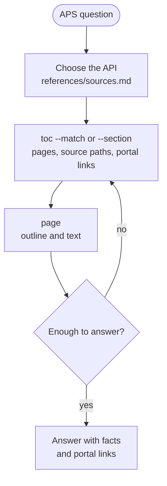

# Skill Catalog

What each skill does, its workflow, and its source files.
Each `SKILL.md` is instructions for the model, so the documentation for people is here, not in `SKILL.md`.

## aps-docs

**Source:** [`skills/aps-docs/SKILL.md`](../skills/aps-docs/SKILL.md)
**Script:** [`scripts/aps_docs.py`](../skills/aps-docs/scripts/aps_docs.py) (tier 2, with [tests](../skills/aps-docs/tests/test_aps_docs.py))
**References:** [sources](../skills/aps-docs/references/sources.md) | [glossary](../skills/aps-docs/references/glossary.md) | [worked example](../skills/aps-docs/references/worked-example.md)
**Needs:** Python 3.9 or later, and internet access. No packages.

Answers questions about Autodesk Platform Services (APS, formerly Forge) from the live documentation, not from the memory of the model.
Start it by name with `/autodesk-skills:aps-docs`, or ask an APS question.

The APS portal is a JavaScript app, so the skill reads the static sources of the same content: a table of contents (TOC) JSON file for each API, and an HTML file for each page.
The script `aps_docs.py` has 6 commands:

| Command | What it does |
|---|---|
| `sources` | Prints the source IDs, and which API answers which kind of question. `--match` prints only the matching rows. |
| `glossary` | Prints APS terms and acronyms. `--match` prints only the matching rows. |
| `example` | Prints a worked example of the method. |
| `toc <source_id>` | Lists the sections of an API, the pages of one section (`--section`), or the pages that match a regex (`--match`). Each page has its source path and its portal link. |
| `page <source path>` | Prints the outline and the text of a page. `--headings` prints only the outline, and `--code` only the code blocks. Table rows show as `cell \| cell`. |
| `portal-url <source path>` | Prints the portal link of a page. |

The portal link comes from the `url_path` chain in the TOC, not from the source path. The 2 are often different (ex. the source `model-derivative/v2/overview.html` is the portal page `model-derivative/v2/developers_guide/overview/`). If a page is not in the TOC, the script guesses from the source path and says so.
The script caches each TOC for 24 hours in the system temp folder.

### Changes from the original skill

The skill started as `aps-docs-portal` from the Autodesk Platform Services `skills` repository.

- A Python script replaces the `curl`, `jq`, and `htmlq` commands, so it works on Windows without extra tools.
- Portal links come from the TOC. The original rule, which rewrote the source path, gave wrong links for many pages.
- The webhook example uses the events in the live docs. The original listed events that do not exist (ex. `dm.item.created`).
- The source table has the current API titles (ex. `acc_v1` is now "Forma APIs").
